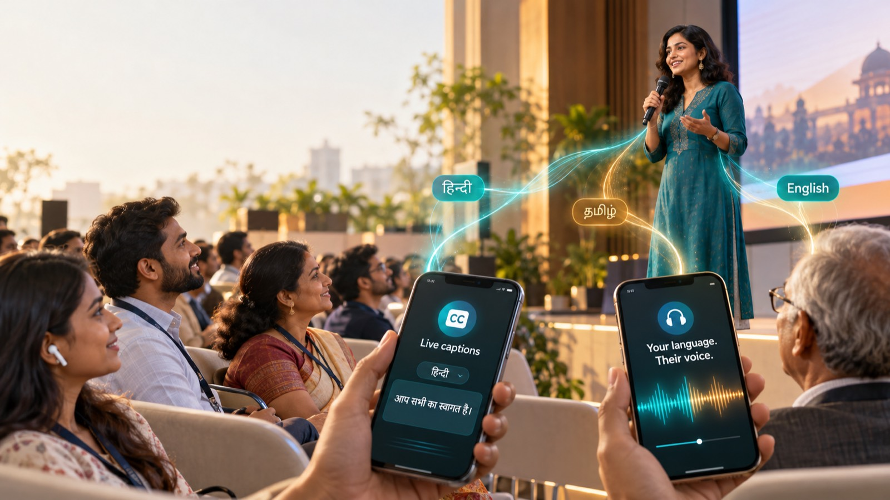

# Dubash

[](https://github.com/UtsavInTech/Dubash/actions/workflows/ci.yml)
[](LICENSE)

**One voice. Every language in the room.**

Dubash gives live captions and translation for events in India, on the
audience's own phones. The speaker talks once; everyone scans a QR code,
picks Hindi, Tamil, Telugu, Kannada, English or another language, and reads
the speaker's words live.

> *Dubash* (from *do-bhashi*, "two-language person"): the interpreters who
> stood between merchants, courts and traders in Madras, Bombay and Calcutta
> from the 17th century on.



## What it does

- **Captions as the speaker speaks**, cut at natural phrase ends, never
  mid-phrase. Recognition by [Sarvam AI](https://www.sarvam.ai) (saaras:v4).
- **Translation into each language people are reading**, and only while
  someone reads it. A reader who switches language gets the history too.
- **The speaker's dialect is kept**: Hinglish stays Hinglish, nothing is
  "corrected" into textbook language.
- **Dictation Bank**: names, places, rituals and brands per event, speaker
  or organisation, with known mis-hearings and approved translations.
- **Scripts**: upload the talk (.txt, .md, .docx); a bounded correction
  stage fixes mis-heard names, but never numbers, negations or meaning.
- **Speaker console** in the browser: any microphone, pause, live word
  fixes, a private speaker link per event.
- **Organiser studio**: events, QR posters, readers and delay per language,
  costs, transcripts (TXT, SRT, VTT). Sign in with Google.
- **Privacy**: audience PINs, revocable QR codes, transcripts that delete
  themselves after a set number of days.
- **Scale**: PostgreSQL, several servers with Redis, backup providers,
  Prometheus and Grafana.

Indian languages: Hindi, Bengali, Marathi, Telugu, Tamil, Gujarati,
Kannada, Malayalam, Odia, Punjabi, and English.

## Quick start

Needs Go 1.26 or later.

```bash
cp .env.example .env            # add SARVAM_API_KEY and a strong ADMIN_TOKEN
set -a; source .env; set +a
go run ./cmd/dubash             # http://localhost:8080, events from rooms.yaml
```

Without a Sarvam key, `go run ./cmd/dubash -fake` shows scripted captions
(Hindi, Telugu, Kannada, Tamil, English) and calls no provider.

- **Website**: `/`; **organiser sign-in**: `/login`; **studio**: `/admin`.
- **Speaker**: the speaker link from the studio, or `/operator/main-hall`.
- **Audience**: the QR code on `/posters`, or `/r/main-hall?lang=te`.

The server listens on this computer only by default. For phones on the
same Wi-Fi use `-addr :8080`, which needs an `ADMIN_TOKEN` of at least 20
random characters (`openssl rand -base64 24`).

## Events

Events are defined in [rooms.yaml](rooms.yaml) (or imported into PostgreSQL
with `go run ./cmd/events -import rooms.yaml`):

```yaml
rooms:
  - id: main-hall
    title: "Main hall"
    source: hi                      # the language usually spoken
    targets: [en, te, kn, ta]       # the languages the audience reads
    asr_mode: codemix               # English words stay in Latin script
    audience_pin: "482193"          # optional: readers enter it once
    exports: readers                # who may download: readers, admin, off
    retention_days: 30              # optional: delete old transcripts
```

## Settings

All settings are environment variables; [.env.example](.env.example)
lists every one with its meaning. The main ones:

| Variable | What it does |
|---|---|
| `SARVAM_API_KEY` | Sarvam speech recognition and translation |
| `ADMIN_TOKEN` | organiser access key (also signs links); 20+ characters on a public address |
| `GOOGLE_CLIENT_ID`, `ORGANISER_EMAILS` | Sign in with Google, for the listed emails |
| `PUBLIC_URL` | the audience address encoded in QR codes |
| `DATABASE_URL` | PostgreSQL for events, transcripts and the Dictation Bank |
| `CORRECTION` | `off`, `rules` or `model` |
| `TRUST_PROXY` | `on` behind a reverse proxy |

## Deploying

- **Zoho Catalyst AppSail**: `deploy/catalyst/package.sh` builds the ZIP;
  start command `python3 launcher.py`. The package runs scripted captions
  (no paid providers) for demos.
- **Docker**: `docker compose up --build` (one server), or
  `deploy/compose.phase4.yml` for several servers with PostgreSQL, Redis,
  nginx, Prometheus and Grafana.
- Before a real event, read [docs/RUNBOOK.md](docs/RUNBOOK.md).

## Documentation

| | |
|---|---|
| [ARCHITECTURE](docs/ARCHITECTURE.md) | how audio becomes captions on every phone |
| [DECISIONS](docs/DECISIONS.md) | why things are the way they are |
| [PROVIDER_NOTES](docs/PROVIDER_NOTES.md) | Sarvam findings, costs, limits |
| [TESTING](docs/TESTING.md) | test suites, benchmark, results |
| [RUNBOOK](docs/RUNBOOK.md) | running an event, incidents |
| [SECURITY_REVIEW](docs/SECURITY_REVIEW.md) | roles, privacy, the review |
| [PHASE4](docs/PHASE4.md) | several servers, failover, monitoring |

## Development

```bash
go test -race ./...             # unit and integration tests
(cd e2e && npm ci && npx playwright install chromium && ./run.sh)   # browser tests
go run ./cmd/dubash-bench       # recognition and translation benchmark
```

## Licence

Apache License 2.0; see [LICENSE](LICENSE). Dubash builds on the
open-source [Lenguaraz](https://github.com/RchrdHndrcks/lenguaraz) project;
[NOTICE](NOTICE) has the credits for it and for the bundled fonts.
